# Conceptual Database Design (ER Model): Freelance Marketplace

**Course:** CS203 - Database Management Systems  
**Institution:** Sardar Vallabhbhai National Institute of Technology (SVNIT), Surat  
**Department:** Department of Computer Science and Engineering  
**Academic Year:** 2026–27  
**Team Name:** Table Ninjas (3 Members)  
**Project Title:** Freelance Marketplace (Mini-Upwork / Fiverr Database System)  
**Document Phase:** Phase B — Conceptual Design (Entity-Relationship Modeling)  
**Reference Document:** [requirements.md](file:///c:/Users/Admin/Desktop/dbms%20project/requirements.md)

---

## 1. Full Entity List with Attributes and Keys

The conceptual model defines the core entities, their domain-specific attributes, candidate keys, and primary keys. Underlined attributes denote Primary Keys (`PK`), while double-underlined or composite notations denote identifying/discriminator keys for weak entities.

### 1.1 Base Entity: `USER` (Superclass)
Represents any authenticated persona in the marketplace.
- **`user_id`** (`INTEGER`, **PK**): Unique system-generated surrogate key.
- **`email`** (`VARCHAR(120)`, **Candidate Key / Unique**): User login identifier.
- **`password_hash`** (`VARCHAR(255)`): Hashed credentials (bcrypt/Argon2).
- **`first_name`** (`VARCHAR(50)`): User's legal first name.
- **`last_name`** (`VARCHAR(50)`): User's legal last name.
- **`phone`** (`VARCHAR(20)`): Contact phone number.
- **`user_role`** (`ENUM('CLIENT', 'FREELANCER', 'ADMIN', 'DUAL')`): Defines platform role.
- **`account_status`** (`ENUM('ACTIVE', 'SUSPENDED', 'DEACTIVATED')`): Account standing.
- **`created_at`** (`TIMESTAMP`): Account registration timestamp.
- **`last_login`** (`TIMESTAMP`, Nullable): Last authenticated access timestamp.

### 1.2 Specialized Entity: `CLIENT` (Subclass of `USER`)
Represents users with project hiring and employer capabilities.
- **`client_id`** (`INTEGER`, **PK**, **FK** $\rightarrow$ `USER.user_id`): Inherited primary identifier.
- **`company_name`** (`VARCHAR(100)`, Nullable): Legal corporate or business trade name.
- **`company_website`** (`VARCHAR(255)`, Nullable): URL to official company site.
- **`billing_address`** (`COMPOSITE`): Composed of `street_address`, `city`, `state`, `country`, `postal_code`.
- **`total_spent`** (`DECIMAL(12,2)`): Aggregate lifetime expenditure across completed contracts (default 0.00).
- **`jobs_posted_count`** (`INTEGER`): Counter of all jobs published (default 0).

### 1.3 Specialized Entity: `FREELANCER` (Subclass of `USER`)
Represents independent service providers offering technical/creative expertise.
- **`freelancer_id`** (`INTEGER`, **PK**, **FK** $\rightarrow$ `USER.user_id`): Inherited primary identifier.
- **`professional_title`** (`VARCHAR(100)`): Professional headline (e.g., "Full-Stack React & Node Architect").
- **`bio_overview`** (`TEXT`): Comprehensive summary of experience, qualifications, and domain focus.
- **`hourly_rate`** (`DECIMAL(8,2)`): Default hourly rate in platform currency units.
- **`availability_status`** (`ENUM('AVAILABLE', 'BUSY', 'NOT_TAKING_WORK')`): Current workload readiness.
- **`years_of_experience`** (`DECIMAL(4,1)`): Professional experience duration in years.
- **`total_earnings`** (`DECIMAL(12,2)`): Total lifetime earnings paid out (default 0.00).
- **`jobs_completed_count`** (`INTEGER`): Counter of successfully closed contracts (default 0).
- **`average_rating`** (`DECIMAL(3,2)`): Cumulative calculated mean rating score [1.00 – 5.00] (default 0.00).

### 1.4 Master Catalog Entity: `SKILL`
Predefined standardized ontology of skills to prevent semantic fragmentation.
- **`skill_id`** (`INTEGER`, **PK**): Unique identifier.
- **`skill_name`** (`VARCHAR(60)`, **Candidate Key / Unique**): Standardized title (e.g., `PostgreSQL`, `React`, `UI/UX Design`, `Docker`).
- **`category`** (`VARCHAR(50)`): Skill taxonomy classification (e.g., `Software Engineering`, `Database Administration`, `Graphic Design`).
- **`description`** (`TEXT`, Nullable): Detailed scope and standard definitions.

### 1.5 Associative Entity: `FREELANCER_SKILL`
Resolves the Many-to-Many ($M:N$) relationship between `FREELANCER` and `SKILL` while storing proficiency metadata.
- **`freelancer_id`** (`INTEGER`, **Composite PK**, **FK** $\rightarrow$ `FREELANCER.freelancer_id`)
- **`skill_id`** (`INTEGER`, **Composite PK**, **FK** $\rightarrow$ `SKILL.skill_id`)
- **`proficiency_level`** (`ENUM('BEGINNER', 'INTERMEDIATE', 'EXPERT')`): Self-assessed competency.
- **`years_experience`** (`DECIMAL(3,1)`): Experience specific to this skill.

### 1.6 Strong Entity: `PORTFOLIO_ITEM`
Showcases individual work samples and previous achievements curated by freelancers.
- **`portfolio_id`** (`INTEGER`, **PK**): Surrogate primary key.
- **`freelancer_id`** (`INTEGER`, **FK** $\rightarrow$ `FREELANCER.freelancer_id`): Owner reference.
- **`title`** (`VARCHAR(120)`): Project showcase title.
- **`description`** (`TEXT`): Project narrative, architecture, and role description.
- **`project_url`** (`VARCHAR(255)`, Nullable): Live demonstrator or GitHub repository link.
- **`completion_date`** (`DATE`, Nullable): Date the showcased project was finished.

### 1.7 Core Entity: `JOB` (Project Requisition)
Published by clients to solicit proposals from freelancers.
- **`job_id`** (`INTEGER`, **PK**): Unique job identifier.
- **`client_id`** (`INTEGER`, **FK** $\rightarrow$ `CLIENT.client_id`): Job creator.
- **`title`** (`VARCHAR(150)`): Concise title summarizing deliverables.
- **`description`** (`TEXT`): Comprehensive scope of work, technical stack, expectations.
- **`category`** (`VARCHAR(60)`): Functional domain category.
- **`payment_type`** (`ENUM('FIXED_PRICE', 'HOURLY')`): Compensation model.
- **`budget`** (`DECIMAL(10,2)`): Client's allocated maximum budget or hourly ceiling.
- **`experience_level`** (`ENUM('ENTRY', 'INTERMEDIATE', 'EXPERT')`): Target seniority level.
- **`duration_days`** (`INTEGER`): Expected project timeline in calendar days.
- **`deadline`** (`DATE`): Proposal submission cutoff date.
- **`job_status`** (`ENUM('DRAFT', 'OPEN', 'IN_PROGRESS', 'COMPLETED', 'CANCELLED')`): Current lifecycle state.
- **`created_at`** (`TIMESTAMP`): Creation timestamp.

### 1.8 Associative Entity: `JOB_SKILL`
Resolves the Many-to-Many ($M:N$) requirement mapping between `JOB` and `SKILL`.
- **`job_id`** (`INTEGER`, **Composite PK**, **FK** $\rightarrow$ `JOB.job_id`)
- **`skill_id`** (`INTEGER`, **Composite PK**, **FK** $\rightarrow$ `SKILL.skill_id`)
- **`is_mandatory`** (`BOOLEAN`): Indicates whether the skill is a strict prerequisite or preferred bonus.

### 1.9 Associative Entity with Attributes: `PROPOSAL` (Bid)
Represents a formal commercial application submitted by a Freelancer for an open Job.
- **`proposal_id`** (`INTEGER`, **PK**): Surrogate key for efficient foreign referencing by contracts.
- **`job_id`** (`INTEGER`, **FK** $\rightarrow$ `JOB.job_id`): Target job posting.
- **`freelancer_id`** (`INTEGER`, **FK** $\rightarrow$ `FREELANCER.freelancer_id`): Bidding freelancer.
  - *Candidate Key Constraint:* `UNIQUE(job_id, freelancer_id)` (A freelancer can submit at most one active proposal per job).
- **`bid_amount`** (`DECIMAL(10,2)`): Total requested compensation.
- **`estimated_delivery_days`** (`INTEGER`): Proposed calendar duration for completion.
- **`cover_letter`** (`TEXT`): Pitch, proposed technical approach, and relevant experience.
- **`proposal_status`** (`ENUM('SUBMITTED', 'SHORTLISTED', 'ACCEPTED', 'REJECTED', 'WITHDRAWN')`): Current bid state.
- **`submitted_at`** (`TIMESTAMP`): Submission timestamp.

### 1.10 Core Entity: `CONTRACT`
The formal bilateral agreement created when a client awards a project to a freelancer via an accepted proposal.
- **`contract_id`** (`INTEGER`, **PK**): Unique contract number.
- **`job_id`** (`INTEGER`, **FK** $\rightarrow$ `JOB.job_id`, **Unique**): Exactly one contract per job.
- **`proposal_id`** (`INTEGER`, **FK** $\rightarrow$ `PROPOSAL.proposal_id`, **Unique**): The accepted proposal that originated this contract.
- **`client_id`** (`INTEGER`, **FK** $\rightarrow$ `CLIENT.client_id`): Hiring party.
- **`freelancer_id`** (`INTEGER`, **FK** $\rightarrow$ `FREELANCER.freelancer_id`): Hired party.
- **`agreed_amount`** (`DECIMAL(10,2)`): Final binding contract amount.
- **`start_date`** (`DATE`): Official commencement date.
- **`end_date`** (`DATE`, Nullable): Completion or termination date.
- **`contract_status`** (`ENUM('ACTIVE', 'COMPLETED', 'TERMINATED', 'DISPUTED')`): High-level operational state.
- **`created_at`** (`TIMESTAMP`): Execution timestamp.

### 1.11 Weak Entity: `MILESTONE`
Segmented deliverables within a fixed-price contract, dependent on `CONTRACT` for existence and identity.
- **`contract_id`** (`INTEGER`, **Composite PK**, **FK** $\rightarrow$ `CONTRACT.contract_id`): Identifying parent reference.
- **`milestone_seq_no`** (`INTEGER`, **Composite PK / Partial Discriminator Key**): Sequential ordering index ($1, 2, 3, \dots, n$).
- **`title`** (`VARCHAR(100)`): Milestone summary (e.g., "Database Schema Design & ERD").
- **`deliverable_description`** (`TEXT`): Detailed deliverables expected for sign-off.
- **`amount`** (`DECIMAL(10,2)`): Escrow tranche allocated for this milestone.
- **`due_date`** (`DATE`): Deliverable milestone deadline.
- **`submission_notes`** (`TEXT`, Nullable): Notes/links submitted by freelancer upon completion.
- **`submission_date`** (`TIMESTAMP`, Nullable): When deliverable was submitted for client review.
- **`milestone_status`** (`ENUM('PENDING', 'FUNDED', 'IN_REVIEW', 'APPROVED', 'DISPUTED')`): State machine indicator.

### 1.12 Core Transaction Entity: `PAYMENT_TRANSACTION`
Immutable financial ledger recording monetary movements between client, escrow, and freelancer.
- **`transaction_id`** (`INTEGER`, **PK**): Unique financial audit reference.
- **`contract_id`** (`INTEGER`, **FK** $\rightarrow$ `CONTRACT.contract_id`): Associated contract.
- **`milestone_seq_no`** (`INTEGER`, Nullable): Specific milestone if the payment relates to milestone escrow release.
- **`sender_id`** (`INTEGER`, **FK** $\rightarrow$ `USER.user_id`): Payer account (Client or Platform Escrow).
- **`receiver_id`** (`INTEGER`, **FK** $\rightarrow$ `USER.user_id`): Payee account (Platform Escrow or Freelancer).
- **`amount`** (`DECIMAL(10,2)`): Monetary value transferred.
- **`transaction_type`** (`ENUM('ESCROW_LOCK', 'MILESTONE_RELEASE', 'REFUND', 'WALLET_DEPOSIT')`): Nature of transfer.
- **`transaction_status`** (`ENUM('PENDING', 'COMPLETED', 'FAILED', 'REVERSED')`): Transaction status.
- **`created_at`** (`TIMESTAMP`): Immutable execution timestamp.

### 1.13 Associative Entity: `REVIEW`
Bidirectional rating and evaluation record exchanged between contracted parties post-completion.
- **`review_id`** (`INTEGER`, **PK**): Unique review identifier.
- **`contract_id`** (`INTEGER`, **FK** $\rightarrow$ `CONTRACT.contract_id`): Mandatory contract reference ensuring genuine verified feedback.
- **`reviewer_id`** (`INTEGER`, **FK** $\rightarrow$ `USER.user_id`): Evaluator.
- **`reviewee_id`** (`INTEGER`, **FK** $\rightarrow$ `USER.user_id`): Person evaluated.
  - *Candidate Key Constraint:* `UNIQUE(contract_id, reviewer_id)` (A user can submit exactly one review per contract).
- **`overall_rating`** (`INTEGER`): Scaled score from $1$ to $5$ stars.
- **`communication_rating`** (`INTEGER`): Sub-score for responsiveness [1–5].
- **`quality_rating`** (`INTEGER`): Sub-score for work quality or specification clarity [1–5].
- **`adherence_rating`** (`INTEGER`): Sub-score for schedule or payment punctuality [1–5].
- **`feedback_comment`** (`TEXT`): Qualitative written review.
- **`created_at`** (`TIMESTAMP`): Review submission timestamp.

### 1.14 Communication Entity: `MESSAGE`
Audit-logged direct communication between parties.
- **`message_id`** (`INTEGER`, **PK**): Unique message index.
- **`contract_id`** (`INTEGER`, **FK** $\rightarrow$ `CONTRACT.contract_id`, Nullable): Set if discussion is under an active contract.
- **`proposal_id`** (`INTEGER`, **FK** $\rightarrow$ `PROPOSAL.proposal_id`, Nullable): Set if discussion is during the pre-contract interview phase.
- **`sender_id`** (`INTEGER`, **FK** $\rightarrow$ `USER.user_id`): Originating party.
- **`receiver_id`** (`INTEGER`, **FK** $\rightarrow$ `USER.user_id`): Recipient party.
- **`message_body`** (`TEXT`): Communication text content.
- **`sent_at`** (`TIMESTAMP`): Dispatch timestamp.
- **`is_read`** (`BOOLEAN`): Read acknowledgement flag.

### 1.15 Arbitration Entity: `DISPUTE`
Conflict tracking ticket raised when deliverables or payments are contested.
- **`dispute_id`** (`INTEGER`, **PK**): Unique dispute ticket.
- **`contract_id`** (`INTEGER`, **FK** $\rightarrow$ `CONTRACT.contract_id`): Contested contract.
- **`milestone_seq_no`** (`INTEGER`, Nullable): Contested milestone number if applicable.
- **`raised_by_user_id`** (`INTEGER`, **FK** $\rightarrow$ `USER.user_id`): Initiating party (Client or Freelancer).
- **`reason`** (`TEXT`): Formal statement of complaint and evidence summary.
- **`dispute_status`** (`ENUM('OPEN', 'UNDER_INVESTIGATION', 'RESOLVED', 'DISMISSED')`): Processing state.
- **`resolution_type`** (`ENUM('REFUND_CLIENT', 'PAYOUT_FREELANCER', 'SPLIT_PROPORTIONAL')`, Nullable): Binding decision.
- **`resolved_by_admin_id`** (`INTEGER`, **FK** $\rightarrow$ `USER.user_id`, Nullable): Admin who adjudicated.
- **`resolved_at`** (`TIMESTAMP`, Nullable): Settlement timestamp.

---

## 2. Relationships with Cardinality and Participation Constraints

The table below summarizes each relationship using standard Crow's Foot cardinality, structural $(min, max)$ participation notation, and explicit business semantics:

| # | Relationship Name | Participating Entities | Cardinality (Crow's Foot) | Structural Constraint $(min, max)$ | Description & Participation Semantics |
|---|---|---|---|---|---|
| **R1** | **User Specialization** | `USER` $\rightarrow$ `CLIENT`, `FREELANCER` | $1 : (0..1)$ | `USER`: $(0, 1)$ `CLIENT`/`FREELANCER`: $(1, 1)$ | Overlapping / Optional specialization. A User can be a Client, a Freelancer, both (Dual), or Admin. Subclasses exhibit **total participation** in `USER`. |
| **R2** | **Client Posts Job** | `CLIENT` $\rightarrow$ `JOB` | $1 : N$ | `CLIENT`: $(0, N)$ `JOB`: $(1, 1)$ | A Client can post zero or many Jobs. A Job **must** be posted by exactly one Client (**total participation** of `JOB`). |
| **R3** | **Freelancer Submits Proposal** | `FREELANCER` $\rightarrow$ `PROPOSAL` | $1 : N$ | `FREELANCER`: $(0, N)$ `PROPOSAL`: $(1, 1)$ | A Freelancer can submit multiple Proposals. Each Proposal belongs to exactly one Freelancer (**total participation**). |
| **R4** | **Job Receives Proposals** | `JOB` $\rightarrow$ `PROPOSAL` | $1 : N$ | `JOB`: $(0, N)$ `PROPOSAL`: $(1, 1)$ | A Job can receive multiple Proposals. A Proposal is submitted for exactly one Job (**total participation**). Together, R3 and R4 make `PROPOSAL` an **associative entity** modeling the $M:N$ bidding relationship. |
| **R5** | **Freelancer Possesses Skills** | `FREELANCER` $\leftrightarrow$ `SKILL` | $M : N$ | `FREELANCER`: $(0, N)$ `SKILL`: $(0, N)$ | Resolved via `FREELANCER_SKILL`. A Freelancer can list multiple Skills with proficiency; a Skill can be possessed by multiple Freelancers. |
| **R6** | **Job Requires Skills** | `JOB` $\leftrightarrow$ `SKILL` | $M : N$ | `JOB`: $(1, N)$ `SKILL`: $(0, N)$ | Resolved via `JOB_SKILL`. A Job must require at least one Skill (**total participation**); a Skill can be required by zero or many Jobs. |
| **R7** | **Freelancer Showcases Portfolio** | `FREELANCER` $\rightarrow$ `PORTFOLIO_ITEM` | $1 : N$ | `FREELANCER`: $(0, N)$ `PORTFOLIO_ITEM`: $(1, 1)$ | A Freelancer can maintain zero or many Portfolio Items; a Portfolio Item belongs to exactly one Freelancer (**total participation**). |
| **R8** | **Contract Awarded From Proposal** | `PROPOSAL` $\rightarrow$ `CONTRACT` | $1 : (0..1)$ | `PROPOSAL`: $(0, 1)$ `CONTRACT`: $(1, 1)$ | Exactly one accepted Proposal generates a Contract. A Contract **must** be tied to exactly one Proposal (**total participation**). |
| **R9** | **Contract Realizes Job** | `JOB` $\rightarrow$ `CONTRACT` | $1 : (0..1)$ | `JOB`: $(0, 1)$ `CONTRACT`: $(1, 1)$ | A Job can have at most one executed Contract. A Contract references exactly one Job (**total participation**). |
| **R10** | **Contract Contains Milestones** | `CONTRACT` $\rightarrow$ `MILESTONE` | $1 : N$ | `CONTRACT`: $(1, N)$ `MILESTONE`: $(1, 1)$ | Identifying relationship for weak entity `MILESTONE`. A Contract contains one or more Milestones; a Milestone cannot exist without its parent Contract (**total participation**). |
| **R11** | **Milestone Triggers Payment** | `MILESTONE` $\rightarrow$ `PAYMENT_TRANSACTION` | $1 : (0..N)$ | `MILESTONE`: $(0, N)$ `PAYMENT_TRANSACTION`: $(0, 1)$ | An approved milestone triggers an Escrow Release payment transaction. Multiple transactions may link if initial escrow funding and payouts are recorded separately. |
| **R12** | **Contract Governs Review** | `CONTRACT` $\rightarrow$ `REVIEW` | $1 : (0..2)$ | `CONTRACT`: $(0, 2)$ `REVIEW`: $(1, 1)$ | A completed Contract yields at most two Reviews (one from Client to Freelancer, one from Freelancer to Client). Each Review requires a valid Contract (**total participation**). |
| **R13** | **Contextual Communication** | `CONTRACT` $\rightarrow$ `MESSAGE` | $1 : N$ | `CONTRACT`: $(0, N)$ `MESSAGE`: $(0, 1)$ | Messages under a contract link to that contract. Messages during bidding link to the `PROPOSAL`. |
| **R14** | **Contract Arbitration** | `CONTRACT` $\rightarrow$ `DISPUTE` | $1 : (0..N)$ | `CONTRACT`: $(0, N)$ `DISPUTE`: $(1, 1)$ | A Contract can have zero or multiple Disputes (e.g., across distinct milestones). Each Dispute must be tied to a parent Contract (**total participation**). |

---

## 3. Weak Entities, Multivalued & Composite Attributes

### 3.1 Identification of Weak Entities
In pure relational theory, a **weak entity** cannot be identified by its own key attributes alone and depends on an identifying relationship with an owner (parent) entity.

1. **`MILESTONE` (Weak Entity):**
   - **Owner Entity:** `CONTRACT`
   - **Identifying Relationship:** `CONTRACT contains MILESTONE`
   - **Partial Key (Discriminator):** `milestone_seq_no` (values $1, 2, 3, \dots$).
   - **Composite Primary Key:** `(contract_id, milestone_seq_no)`.
   - **Justification:** Milestone #1 has no independent semantic meaning across the marketplace; its identity is inextricably bound to Contract #42. If the Contract record is removed, its dependent milestones cease to exist (cascade semantics).

### 3.2 Multivalued Attributes & Relational Resolutions
In conceptual ER modeling, multivalued attributes must be normalized into dedicated relational structures to avoid First Normal Form (1NF) violations:

1. **Freelancer Skills:** A freelancer possesses multiple skills (multivalued).
   - *Resolution:* Modeled as a separate master entity `SKILL` and an associative entity `FREELANCER_SKILL` storing proficiency levels and years of experience.
2. **Job Required Skills:** A job requisition requires multiple skills (multivalued).
   - *Resolution:* Modeled via the associative entity `JOB_SKILL`, which annotates whether a required skill is mandatory or optional.
3. **Portfolio URLs / Project Work Samples:** A freelancer showcases multiple portfolio items.
   - *Resolution:* Normalized into the dependent entity `PORTFOLIO_ITEM`, allowing each sample to store its own title, description, URL, and date.

### 3.3 Composite Attributes & Decomposition
1. **`billing_address` (under `CLIENT`):**
   - *Decomposition:* Decomposed into atomic components: `street_address`, `city`, `state`, `country`, and `postal_code`.
2. **`User Name` (under `USER`):**
   - *Decomposition:* Decomposed into `first_name` and `last_name` to allow localized sorting and search operations.

---

## 4. Business Rules and Semantic Integrity Constraints

The conceptual model enforces critical business and relational integrity rules:

### 4.1 Bidding & Job State Rules
1. **Proposal Eligibility:** A Freelancer can submit a `PROPOSAL` for a `JOB` **if and only if** `JOB.job_status == 'OPEN'` and `CURRENT_DATE <= JOB.deadline`.
2. **Unique Bidding Invariant:** A Freelancer cannot submit duplicate bids for the same job. Enforced by:
   $$\text{Candidate Key: } \mathbf{UNIQUE(job\_id, freelancer\_id)}$$
3. **Self-Bidding Prohibition:** A user acting as a Client cannot submit a Proposal for a Job that they themselves posted (`PROPOSAL.freelancer_id \ne JOB.client_id`).

### 4.2 Contract Execution & Escrow Rules
4. **Single Contract Award:** A Job can have at most one executed Contract. When a client accepts a proposal (`PROPOSAL.proposal_status = 'ACCEPTED'`), the corresponding Job transitions to `'IN_PROGRESS'`, all rival proposals on that job are automatically marked `'REJECTED'`, and exactly one `CONTRACT` instance is created.
5. **Milestone Financial Conservation:** For fixed-price contracts, the sum of all milestone allocations must equal the total agreed contract price:
   $$\sum_{i=1}^{n} \text{MILESTONE.amount}_i = \text{CONTRACT.agreed\_amount}$$
6. **Escrow Solvency Guarantee:** A milestone can only transition to `'FUNDED'` if the client's wallet contains sufficient unencumbered balance:
   $$\text{Client.Available\_Balance} \ge \text{MILESTONE.amount}$$
   Upon funding, the amount is atomically moved from `Available_Balance` to `Escrow_Held_Balance`.
7. **Release Invariant:** Milestone payout (`'APPROVED'`) releases escrowed funds directly to the freelancer's wallet balance. Payout cannot exceed the pre-funded milestone tranche.

### 4.3 Review & Reputation Invariants
8. **Verified Contract Prerequisite:** A `REVIEW` can **only** be submitted if the associated contract has reached terminal status (`CONTRACT.contract_status == 'COMPLETED'`).
9. **Bidirectional Bound:** Each party may submit at most one review per contract:
   $$\text{Candidate Key: } \mathbf{UNIQUE(contract\_id, reviewer\_id)}$$
10. **Non-Self-Review:** A user cannot review themselves (`REVIEW.reviewer_id \ne REVIEW.reviewee_id`).
11. **Rating Domain Bounds:** All quantitative scores are strictly bounded:
   $$1 \le \text{overall\_rating, communication\_rating, quality\_rating, adherence\_rating} \le 5$$

### 4.4 Dispute Resolution Rules
12. **Dispute Timing:** A `DISPUTE` can only be raised against a Contract or Milestone whose status is `'FUNDED'` or `'IN_REVIEW'` before funds are released.
13. **Administrative Exclusivity:** Only users with `USER.user_role == 'ADMIN'` are authorized to populate `DISPUTE.resolved_by_admin_id` and execute binding payout or refund adjustments.

---

## 5. Architectural & Design Justifications

### 5.1 Why Model `PROPOSAL` as an Associative Entity?
In traditional ER modeling, a bid represents an $M:N$ relationship between `FREELANCER` and `JOB`. However, treating a bid as a pure relationship without entity status fails because:
- **Rich Descriptive Attributes:** A proposal has significant independent state: `bid_amount`, `estimated_delivery_days`, `cover_letter`, `submitted_at`, and its own operational state machine (`SUBMITTED`, `SHORTLISTED`, `ACCEPTED`, `REJECTED`).
- **Target of External Relationships:** Once a client accepts a bid, that specific proposal becomes the legal origin of a `CONTRACT` ($1:1$ relationship with Contract). In pure relational theory, relationships cannot directly participate in other relationships. Promoting `PROPOSAL` to an **associative entity** (or intersection entity with surrogate key `proposal_id`) elegantly allows `CONTRACT` and `MESSAGE` to establish direct foreign key relationships with it.

### 5.2 Why Generalize/Specialize `USER` into `CLIENT` and `FREELANCER`?
The marketplace has distinct user personas with overlapping core data:
- **Common Superclass (`USER`):** All personas share authentication credentials, legal names, email addresses, phone numbers, password hashes, and security audit logs. Generalizing these into a single `USER` superclass eliminates redundant schema definitions and permits a unified authentication mechanism.
- **Specialized Subclasses (`CLIENT` vs. `FREELANCER`):**
  - Clients require corporate billing addresses, company registration data, total spend metrics, and hiring counters.
  - Freelancers require professional titles, portfolio showcases, hourly rate quotes, skill proficiencies, and calculated public reputation scores.
- **Support for Dual-Role Personas:** By modeling this specialization as **optional and overlapping**, a single individual (`USER`) can act as a Client on one project and work as a Freelancer on another without creating duplicate accounts or bifurcating their login credentials.

### 5.3 Why Model `MILESTONE` as a Weak Entity?
Milestones have no independent lifecycle or cross-project identity. A milestone labeled "Phase 1: Wireframing" cannot exist without its enclosing Contract. Modeling `MILESTONE` as an ID-dependent weak entity with composite key `(contract_id, milestone_seq_no)` guarantees:
- Strict cascading deletion and archiving semantics.
- Natural sequential ordering per contract without requiring global UUID overhead.
- Total existential dependency on a verified legal contract.

### 5.4 Why Route `REVIEW` Through `CONTRACT`?
Public freelance platforms suffer from fraudulent and unverified reviews. In this ER design, `REVIEW` has a mandatory foreign key referencing `CONTRACT`. Because a `CONTRACT` can only be generated from a funded and accepted proposal, fake reviews are architecturally impossible: nobody can review a freelancer without an executed and completed contract.

---

## 6. Complete Mermaid ER Diagram

```mermaid
erDiagram
    USER {
        int user_id PK "Unique Surrogate Identifier"
        string email UK "Unique Login Email"
        string password_hash "Bcrypt Encrypted Hash"
        string first_name "Legal First Name"
        string last_name "Legal Last Name"
        string phone "Contact Number"
        string user_role "CLIENT, FREELANCER, ADMIN, DUAL"
        string account_status "ACTIVE, SUSPENDED, DEACTIVATED"
        datetime created_at "Registration Timestamp"
        datetime last_login "Last Access Timestamp"
    }

    CLIENT {
        int client_id PK,FK "References USER.user_id"
        string company_name "Corporate Name"
        string company_website "Website URL"
        string street_address "Decomposed Billing Address"
        string city "Billing City"
        string state "Billing State"
        string country "Billing Country"
        string postal_code "Postal / ZIP"
        decimal total_spent "Cumulative Payments"
        int jobs_posted_count "Total Job Postings"
    }

    FREELANCER {
        int freelancer_id PK,FK "References USER.user_id"
        string professional_title "Headline"
        string bio_overview "Professional Bio"
        decimal hourly_rate "Base Hourly Price"
        string availability_status "AVAILABLE, BUSY, UNAVAILABLE"
        decimal years_of_experience "Total Industry Years"
        decimal total_earnings "Cumulative Payouts"
        int jobs_completed_count "Total Finished Contracts"
        decimal average_rating "Calculated Mean [1.00-5.00]"
    }

    SKILL {
        int skill_id PK "Unique Identifier"
        string skill_name UK "Standardized Name"
        string category "Skill Taxonomy Category"
        string description "Domain Definition"
    }

    FREELANCER_SKILL {
        int freelancer_id PK,FK "References FREELANCER"
        int skill_id PK,FK "References SKILL"
        string proficiency_level "BEGINNER, INTERMEDIATE, EXPERT"
        decimal years_experience "Skill-specific Years"
    }

    PORTFOLIO_ITEM {
        int portfolio_id PK "Unique Identifier"
        int freelancer_id FK "References FREELANCER"
        string title "Showcase Title"
        string description "Project Narrative"
        string project_url "Demo or Repository Link"
        date completion_date "Finished Date"
    }

    JOB {
        int job_id PK "Unique Identifier"
        int client_id FK "References CLIENT"
        string title "Job Heading"
        string description "Scope of Work"
        string category "Domain Classification"
        string payment_type "FIXED_PRICE, HOURLY"
        decimal budget "Allocated Budget"
        string experience_level "ENTRY, INTERMEDIATE, EXPERT"
        int duration_days "Estimated Duration"
        date deadline "Bidding Cutoff Date"
        string job_status "DRAFT, OPEN, IN_PROGRESS, COMPLETED, CANCELLED"
        datetime created_at "Publication Timestamp"
    }

    JOB_SKILL {
        int job_id PK,FK "References JOB"
        int skill_id PK,FK "References SKILL"
        boolean is_mandatory "Mandatory vs Preferred Flag"
    }

    PROPOSAL {
        int proposal_id PK "Surrogate Identifier"
        int job_id FK "References JOB"
        int freelancer_id FK "References FREELANCER"
        decimal bid_amount "Proposed Compensation"
        int estimated_delivery_days "Turnaround Time in Days"
        string cover_letter "Pitch & Methodology"
        string proposal_status "SUBMITTED, SHORTLISTED, ACCEPTED, REJECTED, WITHDRAWN"
        datetime submitted_at "Timestamp of Bid"
    }

    CONTRACT {
        int contract_id PK "Unique Identifier"
        int job_id UK,FK "References JOB (1:1)"
        int proposal_id UK,FK "References PROPOSAL (1:1)"
        int client_id FK "References CLIENT"
        int freelancer_id FK "References FREELANCER"
        decimal agreed_amount "Final Price"
        date start_date "Commencement Date"
        date end_date "Closure Date"
        string contract_status "ACTIVE, COMPLETED, TERMINATED, DISPUTED"
        datetime created_at "Award Timestamp"
    }

    MILESTONE {
        int contract_id PK,FK "Identifying Parent Reference"
        int milestone_seq_no PK "Partial Discriminator (1..N)"
        string title "Milestone Name"
        string deliverable_description "Deliverable Specification"
        decimal amount "Tranche Value"
        date due_date "Delivery Deadline"
        string submission_notes "Freelancer Deliverable Notes"
        datetime submission_date "Submission Timestamp"
        string milestone_status "PENDING, FUNDED, IN_REVIEW, APPROVED, DISPUTED"
    }

    PAYMENT_TRANSACTION {
        int transaction_id PK "Unique Audit Reference"
        int contract_id FK "References CONTRACT"
        int milestone_seq_no FK "References MILESTONE (Nullable)"
        int sender_id FK "References USER (Payer)"
        int receiver_id FK "References USER (Payee)"
        decimal amount "Transfer Value"
        string transaction_type "ESCROW_LOCK, MILESTONE_RELEASE, REFUND, WALLET_DEPOSIT"
        string transaction_status "PENDING, COMPLETED, FAILED, REVERSED"
        datetime created_at "Execution Timestamp"
    }

    REVIEW {
        int review_id PK "Unique Identifier"
        int contract_id FK "References CONTRACT"
        int reviewer_id FK "References USER"
        int reviewee_id FK "References USER"
        int overall_rating "Overall Score [1-5]"
        int communication_rating "Sub-score [1-5]"
        int quality_rating "Sub-score [1-5]"
        int adherence_rating "Sub-score [1-5]"
        string feedback_comment "Written Testimonial"
        datetime created_at "Submission Timestamp"
    }

    MESSAGE {
        int message_id PK "Unique Identifier"
        int contract_id FK "References CONTRACT (Nullable)"
        int proposal_id FK "References PROPOSAL (Nullable)"
        int sender_id FK "References USER"
        int receiver_id FK "References USER"
        string message_body "Text Content"
        datetime sent_at "Dispatch Timestamp"
        boolean is_read "Read Acknowledgement"
    }

    DISPUTE {
        int dispute_id PK "Unique Identifier"
        int contract_id FK "References CONTRACT"
        int milestone_seq_no FK "References MILESTONE (Nullable)"
        int raised_by_user_id FK "References USER"
        string reason "Grievance Detail & Evidence"
        string dispute_status "OPEN, UNDER_INVESTIGATION, RESOLVED, DISMISSED"
        string resolution_type "REFUND_CLIENT, PAYOUT_FREELANCER, SPLIT_PROPORTIONAL"
        int resolved_by_admin_id FK "References USER (Admin)"
        datetime resolved_at "Resolution Timestamp"
    }

    %% Specialization / Generalization Relationships
    USER ||--o| CLIENT : "specializes into"
    USER ||--o| FREELANCER : "specializes into"

    %% Client Posting Workflow
    CLIENT ||--o{ JOB : "posts"

    %% Freelancer Portfolio & Skills
    FREELANCER ||--o{ PORTFOLIO_ITEM : "showcases"
    FREELANCER ||--|{ FREELANCER_SKILL : "possesses"
    SKILL ||--o{ FREELANCER_SKILL : "classified in"

    %% Job Requirements
    JOB ||--|{ JOB_SKILL : "specifies"
    SKILL ||--o{ JOB_SKILL : "required by"

    %% Proposal Associative Bidding Flow
    JOB ||--o{ PROPOSAL : "receives bids"
    FREELANCER ||--o{ PROPOSAL : "submits"

    %% Contract Award Workflow
    PROPOSAL ||--o| CONTRACT : "awarded as"
    JOB ||--o| CONTRACT : "governed by"
    CLIENT ||--o{ CONTRACT : "employs via"
    FREELANCER ||--o{ CONTRACT : "serves under"

    %% Milestone Execution (Weak Entity)
    CONTRACT ||--|{ MILESTONE : "composed of"

    %% Payment & Escrow
    CONTRACT ||--o{ PAYMENT_TRANSACTION : "incurs"
    MILESTONE ||--o{ PAYMENT_TRANSACTION : "triggers release of"
    USER ||--o{ PAYMENT_TRANSACTION : "sends"
    USER ||--o{ PAYMENT_TRANSACTION : "receives"

    %% Communication
    CONTRACT ||--o{ MESSAGE : "context for"
    PROPOSAL ||--o{ MESSAGE : "inquiry context"
    USER ||--o{ MESSAGE : "dispatches"
    USER ||--o{ MESSAGE : "reads"

    %% Post-Contract Reputation
    CONTRACT ||--o{ REVIEW : "evaluated by"
    USER ||--o{ REVIEW : "submits"
    USER ||--o{ REVIEW : "evaluated in"

    %% Arbitration & Disputes
    CONTRACT ||--o{ DISPUTE : "contested under"
    MILESTONE ||--o{ DISPUTE : "subject of"
    USER ||--o{ DISPUTE : "raises"
    USER ||--o{ DISPUTE : "adjudicates"
```

---

## 7. Written Walkthrough & Data Flow Analysis of the ER Diagram

The ER diagram visually articulates the five distinct stages of the marketplace lifecycle:

1. **Identity & Profiling Layer:**
   - The central `USER` superclass manages security, credentials, and access roles.
   - Users extend into `CLIENT` (hiring history, corporate entity, billing address) and/or `FREELANCER` (hourly rate, headline, bio, experience).
   - Freelancers populate their `PORTFOLIO_ITEM` showcases and link themselves to standardized `SKILL` entries via `FREELANCER_SKILL`, annotating their proficiency and domain tenure.

2. **Job Definition & Matching Layer:**
   - A `CLIENT` creates a `JOB`, defining budget, delivery duration, and scope.
   - The job is linked to prerequisite skills via `JOB_SKILL`, identifying mandatory vs. optional skill sets. This enables indexing and fast candidate-to-job matching queries.

3. **Bidding & Associative Proposal Layer:**
   - Freelancers locate open jobs and submit a `PROPOSAL`. The `PROPOSAL` entity resolves the $M:N$ relationship between `FREELANCER` and `JOB`, encapsulating bid pricing, delivery timelines, and cover letters.
   - Pre-contract messaging occurs through `MESSAGE`, referencing the `proposal_id`.

4. **Contract Execution & Milestone Escrow Layer:**
   - When the client accepts a bid, the `PROPOSAL` is marked `'ACCEPTED'`, and a formal `CONTRACT` is generated ($1:1$ with the accepted proposal and job).
   - The contract decomposes into one or more `MILESTONE` records (modeled as a weak entity identified by `(contract_id, milestone_seq_no)`).
   - Each milestone is funded by locking client balance into escrow, represented by a record in `PAYMENT_TRANSACTION`.
   - When the freelancer submits deliverables and the client approves, a milestone release `PAYMENT_TRANSACTION` transfers escrowed funds to the freelancer.

5. **Arbitration & Reputation Layer:**
   - If a dispute arises over deliverables, a `DISPUTE` record is raised, freezing milestone payouts until a designated `ADMIN` investigates communication logs (`MESSAGE`) and issues a binding resolution.
   - Upon successful contract completion, both client and freelancer submit bidirectional `REVIEW` records tied to the `contract_id`. The calculated scores dynamically update `FREELANCER.average_rating`, guaranteeing verified, fraud-free platform reputation.
