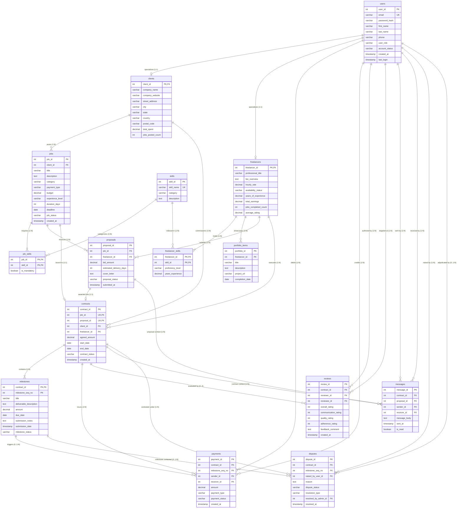

# Logical Database Design & Relational Schema Mapping: Freelance Marketplace

**Course:** CS203 - Database Management Systems  
**Institution:** Sardar Vallabhbhai National Institute of Technology (SVNIT), Surat  
**Department:** Department of Computer Science and Engineering  
**Academic Year:** 2026–27  
**Team Name:** Table Ninjas (3 Members)  
**Project Title:** Freelance Marketplace (Table Ninjas Database System)  
**Document Phase:** Phase C — Logical Design & Relational Normalization  
**Reference Documents:** [requirements.md](file:///c:/Users/Admin/Desktop/dbms%20project/requirements.md) | [conceptual_design.md](file:///c:/Users/Admin/Desktop/dbms%20project/conceptual_design.md)

---

## 1. Relational Schema & Table Definitions

The conceptual ER model has been mapped to a strict relational schema. All tables feature complete column specifications, data types, primary keys, foreign key references with referential actions (`ON DELETE`, `ON UPDATE`), nullability, uniqueness, and check constraints.

### 1.1 `users` Table (Superclass Base Relation)
Stores core authentication and identity data common to all platform participants.

```sql
CREATE TABLE users (
    user_id          INT AUTO_INCREMENT,
    email            VARCHAR(120) NOT NULL,
    password_hash    VARCHAR(255) NOT NULL,
    first_name       VARCHAR(50)  NOT NULL,
    last_name        VARCHAR(50)  NOT NULL,
    phone            VARCHAR(20)  NULL,
    user_role        VARCHAR(20)  NOT NULL,
    account_status   VARCHAR(20)  NOT NULL DEFAULT 'ACTIVE',
    created_at       TIMESTAMP    NOT NULL DEFAULT CURRENT_TIMESTAMP,
    last_login       TIMESTAMP    NULL,

    CONSTRAINT pk_users PRIMARY KEY (user_id),
    CONSTRAINT uq_users_email UNIQUE (email),
    CONSTRAINT chk_users_role CHECK (user_role IN ('CLIENT', 'FREELANCER', 'ADMIN', 'DUAL')),
    CONSTRAINT chk_users_status CHECK (account_status IN ('ACTIVE', 'SUSPENDED', 'DEACTIVATED'))
);
```

### 1.2 `clients` Table (Specialized Subclass Relation)
Stores commercial hiring profiles. Shares its primary key with `users.user_id` (Class Table Inheritance).

```sql
CREATE TABLE clients (
    client_id         INT NOT NULL,
    company_name      VARCHAR(100) NULL,
    company_website   VARCHAR(255) NULL,
    street_address    VARCHAR(150) NULL,
    city              VARCHAR(60)  NULL,
    state             VARCHAR(60)  NULL,
    country           VARCHAR(60)  NULL,
    postal_code       VARCHAR(20)  NULL,
    total_spent       DECIMAL(12,2) NOT NULL DEFAULT 0.00,
    jobs_posted_count INT           NOT NULL DEFAULT 0,

    CONSTRAINT pk_clients PRIMARY KEY (client_id),
    CONSTRAINT fk_clients_user FOREIGN KEY (client_id)
        REFERENCES users (user_id) ON DELETE CASCADE ON UPDATE CASCADE,
    CONSTRAINT chk_clients_total_spent CHECK (total_spent >= 0.00),
    CONSTRAINT chk_clients_jobs_count CHECK (jobs_posted_count >= 0)
);
```

### 1.3 `freelancers` Table (Specialized Subclass Relation)
Stores professional service provider profiles, rate quotes, and aggregated ratings.

```sql
CREATE TABLE freelancers (
    freelancer_id        INT NOT NULL,
    professional_title   VARCHAR(100) NOT NULL,
    bio_overview         TEXT         NULL,
    hourly_rate          DECIMAL(8,2) NOT NULL DEFAULT 0.00,
    availability_status  VARCHAR(25)  NOT NULL DEFAULT 'AVAILABLE',
    years_of_experience  DECIMAL(4,1) NOT NULL DEFAULT 0.0,
    total_earnings       DECIMAL(12,2) NOT NULL DEFAULT 0.00,
    jobs_completed_count INT           NOT NULL DEFAULT 0,
    average_rating       DECIMAL(3,2)  NOT NULL DEFAULT 0.00,

    CONSTRAINT pk_freelancers PRIMARY KEY (freelancer_id),
    CONSTRAINT fk_freelancers_user FOREIGN KEY (freelancer_id)
        REFERENCES users (user_id) ON DELETE CASCADE ON UPDATE CASCADE,
    CONSTRAINT chk_freelancers_rate CHECK (hourly_rate >= 0.00),
    CONSTRAINT chk_freelancers_exp CHECK (years_of_experience >= 0.0),
    CONSTRAINT chk_freelancers_earnings CHECK (total_earnings >= 0.00),
    CONSTRAINT chk_freelancers_jobs CHECK (jobs_completed_count >= 0),
    CONSTRAINT chk_freelancers_rating CHECK (average_rating BETWEEN 0.00 AND 5.00),
    CONSTRAINT chk_freelancers_avail CHECK (availability_status IN ('AVAILABLE', 'BUSY', 'NOT_TAKING_WORK'))
);
```

### 1.4 `skills` Table (Master Catalog)
Standardized ontology of technical, domain, and creative proficiencies.

```sql
CREATE TABLE skills (
    skill_id    INT AUTO_INCREMENT,
    skill_name  VARCHAR(60) NOT NULL,
    category    VARCHAR(60) NOT NULL,
    description TEXT        NULL,

    CONSTRAINT pk_skills PRIMARY KEY (skill_id),
    CONSTRAINT uq_skills_name UNIQUE (skill_name)
);
```

### 1.5 `freelancer_skills` Table (Junction Entity: Freelancer $\leftrightarrow$ Skill)
Resolves $M:N$ association and stores proficiency metadata per skill.

```sql
CREATE TABLE freelancer_skills (
    freelancer_id     INT NOT NULL,
    skill_id          INT NOT NULL,
    proficiency_level VARCHAR(20)  NOT NULL DEFAULT 'INTERMEDIATE',
    years_experience  DECIMAL(3,1) NOT NULL DEFAULT 1.0,

    CONSTRAINT pk_freelancer_skills PRIMARY KEY (freelancer_id, skill_id),
    CONSTRAINT fk_fskills_freelancer FOREIGN KEY (freelancer_id)
        REFERENCES freelancers (freelancer_id) ON DELETE CASCADE ON UPDATE CASCADE,
    CONSTRAINT fk_fskills_skill FOREIGN KEY (skill_id)
        REFERENCES skills (skill_id) ON DELETE RESTRICT ON UPDATE CASCADE,
    CONSTRAINT chk_fskills_proficiency CHECK (proficiency_level IN ('BEGINNER', 'INTERMEDIATE', 'EXPERT')),
    CONSTRAINT chk_fskills_years CHECK (years_experience >= 0.0)
);
```

### 1.6 `portfolio_items` Table (Dependent Work Showcases)
Individual project showcases curated by freelancers.

```sql
CREATE TABLE portfolio_items (
    portfolio_id    INT AUTO_INCREMENT,
    freelancer_id   INT NOT NULL,
    title           VARCHAR(120) NOT NULL,
    description     TEXT         NULL,
    project_url     VARCHAR(255) NULL,
    completion_date DATE         NULL,

    CONSTRAINT pk_portfolio_items PRIMARY KEY (portfolio_id),
    CONSTRAINT fk_portfolio_freelancer FOREIGN KEY (freelancer_id)
        REFERENCES freelancers (freelancer_id) ON DELETE CASCADE ON UPDATE CASCADE
);
```

### 1.7 `jobs` Table (Project Postings)
Client-published project requisitions.

```sql
CREATE TABLE jobs (
    job_id           INT AUTO_INCREMENT,
    client_id        INT          NOT NULL,
    title            VARCHAR(150) NOT NULL,
    description      TEXT         NOT NULL,
    category         VARCHAR(60)  NOT NULL,
    payment_type     VARCHAR(20)  NOT NULL DEFAULT 'FIXED_PRICE',
    budget           DECIMAL(10,2) NOT NULL,
    experience_level VARCHAR(20)  NOT NULL DEFAULT 'INTERMEDIATE',
    duration_days    INT          NOT NULL,
    deadline         DATE         NOT NULL,
    job_status       VARCHAR(20)  NOT NULL DEFAULT 'OPEN',
    created_at       TIMESTAMP    NOT NULL DEFAULT CURRENT_TIMESTAMP,

    CONSTRAINT pk_jobs PRIMARY KEY (job_id),
    CONSTRAINT fk_jobs_client FOREIGN KEY (client_id)
        REFERENCES clients (client_id) ON DELETE RESTRICT ON UPDATE CASCADE,
    CONSTRAINT chk_jobs_payment_type CHECK (payment_type IN ('FIXED_PRICE', 'HOURLY')),
    CONSTRAINT chk_jobs_budget CHECK (budget > 0.00),
    CONSTRAINT chk_jobs_duration CHECK (duration_days > 0),
    CONSTRAINT chk_jobs_experience CHECK (experience_level IN ('ENTRY', 'INTERMEDIATE', 'EXPERT')),
    CONSTRAINT chk_jobs_status CHECK (job_status IN ('DRAFT', 'OPEN', 'IN_PROGRESS', 'COMPLETED', 'CANCELLED'))
);
```

### 1.8 `job_skills` Table (Junction Entity: Job $\leftrightarrow$ Skill)
Resolves $M:N$ skill requirements for job postings.

```sql
CREATE TABLE job_skills (
    job_id       INT NOT NULL,
    skill_id     INT NOT NULL,
    is_mandatory BOOLEAN NOT NULL DEFAULT TRUE,

    CONSTRAINT pk_job_skills PRIMARY KEY (job_id, skill_id),
    CONSTRAINT fk_jskills_job FOREIGN KEY (job_id)
        REFERENCES jobs (job_id) ON DELETE CASCADE ON UPDATE CASCADE,
    CONSTRAINT fk_jskills_skill FOREIGN KEY (skill_id)
        REFERENCES skills (skill_id) ON DELETE RESTRICT ON UPDATE CASCADE
);
```

### 1.9 `proposals` Table (Associative Bidding Relation)
Commercial proposals submitted by freelancers for open jobs.

```sql
CREATE TABLE proposals (
    proposal_id              INT AUTO_INCREMENT,
    job_id                   INT          NOT NULL,
    freelancer_id            INT          NOT NULL,
    bid_amount               DECIMAL(10,2) NOT NULL,
    estimated_delivery_days  INT          NOT NULL,
    cover_letter             TEXT         NOT NULL,
    proposal_status          VARCHAR(20)  NOT NULL DEFAULT 'SUBMITTED',
    submitted_at             TIMESTAMP    NOT NULL DEFAULT CURRENT_TIMESTAMP,

    CONSTRAINT pk_proposals PRIMARY KEY (proposal_id),
    CONSTRAINT uq_proposals_job_freelancer UNIQUE (job_id, freelancer_id),
    CONSTRAINT fk_proposals_job FOREIGN KEY (job_id)
        REFERENCES jobs (job_id) ON DELETE CASCADE ON UPDATE CASCADE,
    CONSTRAINT fk_proposals_freelancer FOREIGN KEY (freelancer_id)
        REFERENCES freelancers (freelancer_id) ON DELETE CASCADE ON UPDATE CASCADE,
    CONSTRAINT chk_proposals_bid CHECK (bid_amount > 0.00),
    CONSTRAINT chk_proposals_days CHECK (estimated_delivery_days > 0),
    CONSTRAINT chk_proposals_status CHECK (proposal_status IN ('SUBMITTED', 'SHORTLISTED', 'ACCEPTED', 'REJECTED', 'WITHDRAWN'))
);
```

### 1.10 `contracts` Table (Execution Agreement)
Bilateral binding contract established between client and freelancer upon proposal acceptance.

```sql
CREATE TABLE contracts (
    contract_id     INT AUTO_INCREMENT,
    job_id          INT          NOT NULL,
    proposal_id     INT          NOT NULL,
    client_id       INT          NOT NULL,
    freelancer_id   INT          NOT NULL,
    agreed_amount   DECIMAL(10,2) NOT NULL,
    start_date      DATE         NOT NULL,
    end_date        DATE         NULL,
    contract_status VARCHAR(20)  NOT NULL DEFAULT 'ACTIVE',
    created_at      TIMESTAMP    NOT NULL DEFAULT CURRENT_TIMESTAMP,

    CONSTRAINT pk_contracts PRIMARY KEY (contract_id),
    CONSTRAINT uq_contracts_job UNIQUE (job_id),
    CONSTRAINT uq_contracts_proposal UNIQUE (proposal_id),
    CONSTRAINT fk_contracts_job FOREIGN KEY (job_id)
        REFERENCES jobs (job_id) ON DELETE RESTRICT ON UPDATE CASCADE,
    CONSTRAINT fk_contracts_proposal FOREIGN KEY (proposal_id)
        REFERENCES proposals (proposal_id) ON DELETE RESTRICT ON UPDATE CASCADE,
    CONSTRAINT fk_contracts_client FOREIGN KEY (client_id)
        REFERENCES clients (client_id) ON DELETE RESTRICT ON UPDATE CASCADE,
    CONSTRAINT fk_contracts_freelancer FOREIGN KEY (freelancer_id)
        REFERENCES freelancers (freelancer_id) ON DELETE RESTRICT ON UPDATE CASCADE,
    CONSTRAINT chk_contracts_amount CHECK (agreed_amount > 0.00),
    CONSTRAINT chk_contracts_status CHECK (contract_status IN ('ACTIVE', 'COMPLETED', 'TERMINATED', 'DISPUTED'))
);
```

### 1.11 `milestones` Table (Weak Entity Relation)
Phase deliverables under a contract. Uses composite primary key `(contract_id, milestone_seq_no)`.

```sql
CREATE TABLE milestones (
    contract_id             INT          NOT NULL,
    milestone_seq_no        INT          NOT NULL,
    title                   VARCHAR(100) NOT NULL,
    deliverable_description TEXT         NOT NULL,
    amount                  DECIMAL(10,2) NOT NULL,
    due_date                DATE         NOT NULL,
    submission_notes        TEXT         NULL,
    submission_date         TIMESTAMP    NULL,
    milestone_status        VARCHAR(20)  NOT NULL DEFAULT 'PENDING',

    CONSTRAINT pk_milestones PRIMARY KEY (contract_id, milestone_seq_no),
    CONSTRAINT fk_milestones_contract FOREIGN KEY (contract_id)
        REFERENCES contracts (contract_id) ON DELETE CASCADE ON UPDATE CASCADE,
    CONSTRAINT chk_milestones_seq CHECK (milestone_seq_no > 0),
    CONSTRAINT chk_milestones_amount CHECK (amount > 0.00),
    CONSTRAINT chk_milestones_status CHECK (milestone_status IN ('PENDING', 'FUNDED', 'IN_REVIEW', 'APPROVED', 'DISPUTED'))
);
```

### 1.12 `payments` Table (Simulated Financial Ledger)
Captures immutable financial transfers (escrow deposits, milestone releases, refunds).

```sql
CREATE TABLE payments (
    payment_id       INT AUTO_INCREMENT,
    contract_id      INT          NOT NULL,
    milestone_seq_no INT          NULL,
    sender_id        INT          NOT NULL,
    receiver_id      INT          NOT NULL,
    amount           DECIMAL(10,2) NOT NULL,
    payment_type     VARCHAR(25)  NOT NULL,
    payment_status   VARCHAR(20)  NOT NULL DEFAULT 'COMPLETED',
    created_at       TIMESTAMP    NOT NULL DEFAULT CURRENT_TIMESTAMP,

    CONSTRAINT pk_payments PRIMARY KEY (payment_id),
    CONSTRAINT fk_payments_contract FOREIGN KEY (contract_id)
        REFERENCES contracts (contract_id) ON DELETE RESTRICT ON UPDATE CASCADE,
    CONSTRAINT fk_payments_milestone FOREIGN KEY (contract_id, milestone_seq_no)
        REFERENCES milestones (contract_id, milestone_seq_no) ON DELETE RESTRICT ON UPDATE CASCADE,
    CONSTRAINT fk_payments_sender FOREIGN KEY (sender_id)
        REFERENCES users (user_id) ON DELETE RESTRICT ON UPDATE CASCADE,
    CONSTRAINT fk_payments_receiver FOREIGN KEY (receiver_id)
        REFERENCES users (user_id) ON DELETE RESTRICT ON UPDATE CASCADE,
    CONSTRAINT chk_payments_amount CHECK (amount > 0.00),
    CONSTRAINT chk_payments_type CHECK (payment_type IN ('ESCROW_LOCK', 'MILESTONE_RELEASE', 'REFUND', 'WALLET_DEPOSIT')),
    CONSTRAINT chk_payments_status CHECK (payment_status IN ('PENDING', 'COMPLETED', 'FAILED', 'REVERSED'))
);
```

### 1.13 `reviews` Table (Post-Contract Bidirectional Ratings)
Stores verified, mutual feedback between contracting parties.

```sql
CREATE TABLE reviews (
    review_id            INT AUTO_INCREMENT,
    contract_id          INT       NOT NULL,
    reviewer_id          INT       NOT NULL,
    reviewee_id          INT       NOT NULL,
    overall_rating       INT       NOT NULL,
    communication_rating INT       NOT NULL,
    quality_rating       INT       NOT NULL,
    adherence_rating     INT       NOT NULL,
    feedback_comment     TEXT      NOT NULL,
    created_at           TIMESTAMP NOT NULL DEFAULT CURRENT_TIMESTAMP,

    CONSTRAINT pk_reviews PRIMARY KEY (review_id),
    CONSTRAINT uq_reviews_contract_reviewer UNIQUE (contract_id, reviewer_id),
    CONSTRAINT fk_reviews_contract FOREIGN KEY (contract_id)
        REFERENCES contracts (contract_id) ON DELETE RESTRICT ON UPDATE CASCADE,
    CONSTRAINT fk_reviews_reviewer FOREIGN KEY (reviewer_id)
        REFERENCES users (user_id) ON DELETE RESTRICT ON UPDATE CASCADE,
    CONSTRAINT fk_reviews_reviewee FOREIGN KEY (reviewee_id)
        REFERENCES users (user_id) ON DELETE RESTRICT ON UPDATE CASCADE,
    CONSTRAINT chk_reviews_distinct_users CHECK (reviewer_id <> reviewee_id),
    CONSTRAINT chk_reviews_overall CHECK (overall_rating BETWEEN 1 AND 5),
    CONSTRAINT chk_reviews_comm CHECK (communication_rating BETWEEN 1 AND 5),
    CONSTRAINT chk_reviews_qual CHECK (quality_rating BETWEEN 1 AND 5),
    CONSTRAINT chk_reviews_adh CHECK (adherence_rating BETWEEN 1 AND 5)
);
```

### 1.14 `messages` Table (Threaded Communication Audit)
Direct communications exchanged under proposals or active contracts.

```sql
CREATE TABLE messages (
    message_id   INT AUTO_INCREMENT,
    contract_id  INT       NULL,
    proposal_id  INT       NULL,
    sender_id    INT       NOT NULL,
    receiver_id  INT       NOT NULL,
    message_body TEXT      NOT NULL,
    sent_at      TIMESTAMP NOT NULL DEFAULT CURRENT_TIMESTAMP,
    is_read      BOOLEAN   NOT NULL DEFAULT FALSE,

    CONSTRAINT pk_messages PRIMARY KEY (message_id),
    CONSTRAINT fk_messages_contract FOREIGN KEY (contract_id)
        REFERENCES contracts (contract_id) ON DELETE CASCADE ON UPDATE CASCADE,
    CONSTRAINT fk_messages_proposal FOREIGN KEY (proposal_id)
        REFERENCES proposals (proposal_id) ON DELETE CASCADE ON UPDATE CASCADE,
    CONSTRAINT fk_messages_sender FOREIGN KEY (sender_id)
        REFERENCES users (user_id) ON DELETE RESTRICT ON UPDATE CASCADE,
    CONSTRAINT fk_messages_receiver FOREIGN KEY (receiver_id)
        REFERENCES users (user_id) ON DELETE RESTRICT ON UPDATE CASCADE,
    CONSTRAINT chk_messages_context CHECK (contract_id IS NOT NULL OR proposal_id IS NOT NULL),
    CONSTRAINT chk_messages_distinct CHECK (sender_id <> receiver_id)
);
```

### 1.15 `disputes` Table (Arbitration Management)
Contested contract milestones adjudicated by platform administrators.

```sql
CREATE TABLE disputes (
    dispute_id           INT AUTO_INCREMENT,
    contract_id          INT         NOT NULL,
    milestone_seq_no     INT         NULL,
    raised_by_user_id    INT         NOT NULL,
    reason               TEXT        NOT NULL,
    dispute_status       VARCHAR(25) NOT NULL DEFAULT 'OPEN',
    resolution_type      VARCHAR(25) NULL,
    resolved_by_admin_id INT         NULL,
    resolved_at          TIMESTAMP   NULL,

    CONSTRAINT pk_disputes PRIMARY KEY (dispute_id),
    CONSTRAINT fk_disputes_contract FOREIGN KEY (contract_id)
        REFERENCES contracts (contract_id) ON DELETE RESTRICT ON UPDATE CASCADE,
    CONSTRAINT fk_disputes_milestone FOREIGN KEY (contract_id, milestone_seq_no)
        REFERENCES milestones (contract_id, milestone_seq_no) ON DELETE RESTRICT ON UPDATE CASCADE,
    CONSTRAINT fk_disputes_raised_by FOREIGN KEY (raised_by_user_id)
        REFERENCES users (user_id) ON DELETE RESTRICT ON UPDATE CASCADE,
    CONSTRAINT fk_disputes_admin FOREIGN KEY (resolved_by_admin_id)
        REFERENCES users (user_id) ON DELETE RESTRICT ON UPDATE CASCADE,
    CONSTRAINT chk_disputes_status CHECK (dispute_status IN ('OPEN', 'UNDER_INVESTIGATION', 'RESOLVED', 'DISMISSED')),
    CONSTRAINT chk_disputes_resolution CHECK (resolution_type IS NULL OR resolution_type IN ('REFUND_CLIENT', 'PAYOUT_FREELANCER', 'SPLIT_PROPORTIONAL'))
);
```

---

## 2. Specialization/Generalization Resolution (`USER` $\rightarrow$ `CLIENT`, `FREELANCER`)

### 2.1 Evaluated Mapping Strategies
When mapping an ER specialization hierarchy to the relational model, three canonical design patterns exist:

| Strategy | Structure | Tradeoffs & Evaluation |
|---|---|---|
| **1. Single Table Inheritance (STI)** | Merge `users`, `clients`, and `freelancers` into a single monolithic `all_users` table with a `role` discriminator. | **Rejected:** Results in a sparse, heavily de-normalized table with dozens of `NULL` columns (clients have null hourly rates; freelancers have null company names). Violates domain nullability rules and breaks 3NF. |
| **2. Concrete Table Inheritance** | Two completely disconnected tables `clients` and `freelancers`, each duplicating user authentication attributes (`email`, `password_hash`). | **Rejected:** Destroys unified authentication, requires redundant unique constraints across tables, and makes dual-role users (a person who is both a client and a freelancer) maintain duplicate login accounts and passwords. |
| **3. Class Table Inheritance (CTI / TPT)** *(Chosen)* | Separate base table `users` plus specialized tables `clients` and `freelancers`, where `client_id` and `freelancer_id` act simultaneously as **Primary Key** and **Foreign Key** referencing `users.user_id`. | **Accepted:** Cleanest relational design. Normalizes attributes, preserves non-null constraints, prevents sparse tables, and cleanly accommodates dual-role accounts. |

### 2.2 Justification for Class Table Inheritance (TPT)
1. **Zero Nullable Column Pollution:** Client-specific columns (`company_name`, `billing_address`) and freelancer-specific columns (`hourly_rate`, `bio_overview`, `years_of_experience`) remain strictly mandatory/optional where appropriate, without forcing unrelated rows to store `NULL`.
2. **First-Class Support for Dual-Role Users:** A single human actor can log in with one email/password combination (`users`), while having corresponding rows in **both** `clients` (allowing them to post jobs) and `freelancers` (allowing them to bid on others' jobs), with `user_role = 'DUAL'`.
3. **Rigid Referential Integrity:** Job foreign keys can explicitly reference `clients(client_id)` while proposal bids reference `freelancers(freelancer_id)`, preventing structural bugs where a freelancer accidentally acts as the hiring client in a contract.

---

## 3. Resolution of Many-to-Many ($M:N$) Relationships

In relational database design, $M:N$ relationships cannot be represented using foreign keys directly within the participating entities without violating First Normal Form (multi-valued repeating attributes) or creating circular dependencies. They are decomposed into **associative junction tables**.

### 3.1 Freelancers to Skills (`freelancer_skills`)
- **Relationship:** A Freelancer possesses many Skills; a Skill is possessed by many Freelancers ($M:N$).
- **Resolution:** Junction table `freelancer_skills`.
- **Composite Primary Key:** `(freelancer_id, skill_id)` ensures that a freelancer cannot associate with the same skill more than once.
- **Payload Attributes:**
  - `proficiency_level` (`BEGINNER`, `INTERMEDIATE`, `EXPERT`): Captures capability tier.
  - `years_experience` (`DECIMAL(3,1)`): Domain tenure for that specific skill.

### 3.2 Jobs to Skills (`job_skills`)
- **Relationship:** A Job posting requires multiple Skills; a Skill is required across multiple Job postings ($M:N$).
- **Resolution:** Junction table `job_skills`.
- **Composite Primary Key:** `(job_id, skill_id)`.
- **Payload Attribute:**
  - `is_mandatory` (`BOOLEAN`): Distinguishes hard prerequisites (e.g., must know SQL) from bonus/preferred proficiencies.

---

## 4. Normalization Walkthrough (1NF $\rightarrow$ 2NF $\rightarrow$ 3NF / BCNF)

To demonstrate rigorous theoretical correctness, we track the schema decomposition starting from an unnormalized state and stepping through 1NF, 2NF, and 3NF/BCNF.

### 4.1 Starting Form: The Unnormalized Universal Relation (UNF)
Consider a naive, monolithic structure representing freelance jobs, client details, proposals, skills, and milestones:

$$\text{UNF\_PLATFORM}(\underline{\text{job\_id}}, \text{title}, \text{client\_name}, \text{client\_email}, \text{billing\_address}, \{\text{skill\_names}\}, \{\text{proposal\_freelancers}, \text{bid\_amounts}\}, \{\text{milestone\_seq}, \text{milestone\_amounts}\})$$

---

### 4.2 Step 1: Progression to First Normal Form (1NF)

> **Definition (1NF):** A relation is in 1NF if and only if all attribute values are atomic (no repeating groups, multi-valued attributes, or composite structures) and each tuple has a unique primary key.

#### Violations in UNF:
1. **Composite Attribute:** `billing_address` contains sub-parts (street, city, state, country, postal code).
2. **Multi-Valued Repeating Groups:**
   - $\{\text{skill\_names}\}$ contains sets of skills per job.
   - $\{\text{proposal\_freelancers}, \text{bid\_amounts}\}$ contains variable sets of bids per job.
   - $\{\text{milestone\_seq}, \text{milestone\_amounts}\}$ contains repeating milestone tranches.

#### 1NF Decomposition:
- Atomicize `billing_address` into `street_address`, `city`, `state`, `country`, `postal_code`.
- Factor out repeating groups into separate relations identified by composite keys:
  - `JOB_SKILLS_FLAT(\underline{\text{job\_id}}, \underline{\text{skill\_name}}, \text{is\_mandatory})`
  - `JOB_PROPOSALS_FLAT(\underline{\text{job\_id}}, \underline{\text{freelancer\_email}}, \text{freelancer\_name}, \text{freelancer\_rate}, \text{bid\_amount}, \text{cover\_letter})`
  - `JOB_MILESTONES_FLAT(\underline{\text{job\_id}}, \underline{\text{milestone\_seq\_no}}, \text{title}, \text{amount})`
  - `JOB_CORE_FLAT(\underline{\text{job\_id}}, \text{title}, \text{client\_email}, \text{client\_name}, \text{city}, \text{country}, \text{budget})`

All attributes are now atomic, achieving **1NF**.

---

### 4.3 Step 2: Progression to Second Normal Form (2NF)

> **Definition (2NF):** A relation is in 2NF if and only if it is in 1NF and every non-prime attribute is **fully functionally dependent** on the primary key (no partial dependencies on a proper subset of any candidate key).

#### Partial Dependency Violations in 1NF Tables:

1. **In `JOB_PROPOSALS_FLAT`:**
   - **Composite Candidate Key:** `(job_id, freelancer_email)`
   - **Functional Dependencies:**
     - $FD_1: \{\text{job\_id}, \text{freelancer\_email}\} \rightarrow \{\text{bid\_amount}, \text{cover\_letter}\}$ *(Full dependency)*
     - $FD_2: \{\text{freelancer\_email}\} \rightarrow \{\text{freelancer\_name}, \text{freelancer\_rate}\}$ *(Partial dependency on part of candidate key!)*
   - **Violation:** `freelancer_name` and `freelancer_rate` depend solely on `freelancer_email`, not on `job_id`.

2. **In `JOB_SKILLS_FLAT`:**
   - **Composite Candidate Key:** `(job_id, skill_id)` (substituting integer surrogate for `skill_name`)
   - **Functional Dependencies:**
     - $FD_3: \{\text{job\_id}, \text{skill\_id}\} \rightarrow \{\text{is\_mandatory}\}$ *(Full dependency)*
     - $FD_4: \{\text{skill\_id}\} \rightarrow \{\text{skill\_name}, \text{category}\}$ *(Partial dependency!)*

#### 2NF Decomposition:

##### Before (Violating 2NF):
```
JOB_PROPOSALS_FLAT (job_id, freelancer_id, bid_amount, cover_letter, freelancer_title, hourly_rate)
  --> Partial Key Dependency: freelancer_id -> (freelancer_title, hourly_rate)
```

##### After (Satisfying 2NF):
Decompose by isolating partially dependent attributes into their own relation:

1. **`freelancers` Table:**
   - **Primary Key:** `freelancer_id`
   - **Attributes:** `freelancer_id`, `professional_title`, `hourly_rate`, `bio_overview`, `years_of_experience`
   - **FD:** $\{\text{freelancer\_id}\} \rightarrow \{\text{professional\_title}, \text{hourly\_rate}, \dots\}$ *(Fully dependent)*

2. **`proposals` Table:**
   - **Primary Key:** `proposal_id` (with alternate key `UNIQUE(job_id, freelancer_id)`)
   - **Attributes:** `proposal_id`, `job_id`, `freelancer_id`, `bid_amount`, `cover_letter`, `estimated_delivery_days`
   - **FD:** $\{\text{job\_id}, \text{freelancer\_id}\} \rightarrow \{\text{bid\_amount}, \text{cover\_letter}, \dots\}$ *(Fully dependent on the entire key)*

3. **`skills` & `job_skills` Tables:**
   - `skills(\underline{\text{skill\_id}}, \text{skill\_name}, \text{category})`
   - `job_skills(\underline{\text{job\_id}}, \underline{\text{skill\_id}}, \text{is\_mandatory})`

All partial key dependencies are eliminated, achieving **2NF**.

---

### 4.4 Step 3: Progression to Third Normal Form (3NF) & BCNF

> **Definition (3NF):** A relation is in 3NF if and only if it is in 2NF and there are no **transitive dependencies** (no non-prime attribute is functionally dependent on another non-prime attribute; i.e., in $X \rightarrow Y$, either $X$ is a superkey or $Y$ is a prime attribute).  
> **Definition (BCNF):** A relation is in BCNF if for every non-trivial functional dependency $X \rightarrow Y$, $X$ is a superkey.

#### Transitive Dependency Violations in 2NF Tables:

1. **In `JOB_CORE_FLAT`:**
   - **Candidate Key:** `job_id`
   - **Functional Dependencies:**
     - $FD_5: \{\text{job\_id}\} \rightarrow \{\text{title}, \text{budget}, \text{client\_id}\}$
     - $FD_6: \{\text{client\_id}\} \rightarrow \{\text{company\_name}, \text{city}, \text{country}, \text{postal\_code}\}$
   - **Violation:** $\{\text{job\_id}\} \rightarrow \{\text{client\_id}\} \rightarrow \{\text{company\_name}, \dots\}$ is a transitive dependency! `company_name` and address details depend on `client_id`, which is not a superkey of `JOB_CORE_FLAT`.

2. **In `CONTRACTS_COMBINED`:**
   - If contract, proposal, and client data were combined:
     - $\{\text{contract\_id}\} \rightarrow \{\text{proposal\_id}\} \rightarrow \{\text{bid\_amount}, \text{freelancer\_id}\}$
   - Would introduce redundant transitive attributes.

#### 3NF / BCNF Decomposition:

##### Before (Violating 3NF):
```
JOB_CORE_FLAT (job_id, title, budget, client_id, company_name, city, country, postal_code)
  --> Transitive Dependency: job_id -> client_id -> (company_name, city, country, postal_code)
```

##### After (Satisfying 3NF & BCNF):
Extract the determinant `client_id` and its dependent attributes into the `clients` table:

1. **`jobs` Table:**
   - **Columns:** `job_id`, `client_id`, `title`, `description`, `category`, `payment_type`, `budget`, `experience_level`, `duration_days`, `deadline`, `job_status`, `created_at`
   - **Determinant:** `job_id` is the superkey. All non-prime attributes depend directly and exclusively on `job_id`.

2. **`clients` Table:**
   - **Columns:** `client_id`, `company_name`, `company_website`, `street_address`, `city`, `state`, `country`, `postal_code`, `total_spent`, `jobs_posted_count`
   - **Determinant:** `client_id` is the superkey.

3. **`users` Table:**
   - Decomposing common authentication credentials from `clients` and `freelancers` into `users(\underline{\text{user\_id}}, \text{email}, \text{password\_hash}, \dots)` ensures that `email \rightarrow user\_id` is clean and all determinants are superkeys.

#### BCNF Verification Summary:
Across every finalized table (`users`, `clients`, `freelancers`, `skills`, `freelancer_skills`, `jobs`, `job_skills`, `proposals`, `contracts`, `milestones`, `payments`, `reviews`, `messages`, `disputes`), every functional dependency $X \rightarrow Y$ has a left-hand determinant $X$ that is a candidate key or superkey. **The schema is fully compliant with 3NF and BCNF.**

---

## 5. Final Normalized Schema Diagram



---

## 6. Justification of Deliberate Denormalization & Engineering Tradeoffs

While the relational schema strictly achieves 3NF/BCNF across all transaction-critical tables, a select few derived numerical attributes were intentionally retained as **controlled denormalization points**:

### 6.1 Retained Denormalized Attributes
1. **`freelancers.average_rating` (`DECIMAL(3,2)`):**
   - *Strict Normal Form Calculation:* `SELECT AVG(overall_rating) FROM reviews WHERE reviewee_id = freelancer_id;`
2. **`freelancers.jobs_completed_count` (`INT`):**
   - *Strict Normal Form Calculation:* `SELECT COUNT(*) FROM contracts WHERE freelancer_id = ? AND contract_status = 'COMPLETED';`
3. **`freelancers.total_earnings` (`DECIMAL(12,2)`):**
   - *Strict Normal Form Calculation:* `SELECT SUM(amount) FROM payments WHERE receiver_id = freelancer_id AND payment_type = 'MILESTONE_RELEASE';`
4. **`clients.total_spent` (`DECIMAL(12,2)`):**
   - *Strict Normal Form Calculation:* `SELECT SUM(amount) FROM payments WHERE sender_id = client_id AND payment_type = 'MILESTONE_RELEASE';`
5. **`clients.jobs_posted_count` (`INT`):**
   - *Strict Normal Form Calculation:* `SELECT COUNT(*) FROM jobs WHERE client_id = ?;`

### 6.2 Architectural Justification & Query Performance
- **Read-to-Write Asymmetry:** In freelance marketplaces, profile views and search/browse queries exceed contract completion and review writes by multiple orders of magnitude ($> 100:1$ read/write ratio).
- **Elimination of Multi-Table Aggregation Joins on Search:** When a client searches for "Expert React Developers with rating $\ge 4.5$ and at least 5 completed jobs", executing `JOIN reviews GROUP BY freelancer_id HAVING AVG(...)` across tens of thousands of rows for every page request causes severe latency spikes and buffer thrashing. Storing `average_rating` and `jobs_completed_count` directly on `freelancers` allows direct B-tree index scans:
  ```sql
  -- Sub-millisecond execution via composite index on (average_rating, jobs_completed_count)
  SELECT freelancer_id, professional_title, hourly_rate, average_rating
  FROM freelancers
  WHERE average_rating >= 4.50 AND jobs_completed_count >= 5;
  ```

### 6.3 Data Consistency Guarantee (Eliminating Anomalies)
To ensure that denormalization does not introduce update anomalies, these cached metrics are **never updated directly by application layer writes**. Instead, consistency is guaranteed through:
1. **Database Triggers:** An `AFTER INSERT ON reviews` trigger atomically recalculates and updates `average_rating` inside the same database transaction.
2. **Atomic Contract State Triggers:** An `AFTER UPDATE ON contracts` trigger increments `jobs_completed_count` when `contract_status` transitions to `'COMPLETED'`.
3. **Payment Ledger Integrity:** A database trigger on `AFTER INSERT ON payments` increments `total_earnings` and `total_spent` only when `payment_status = 'COMPLETED'`.
